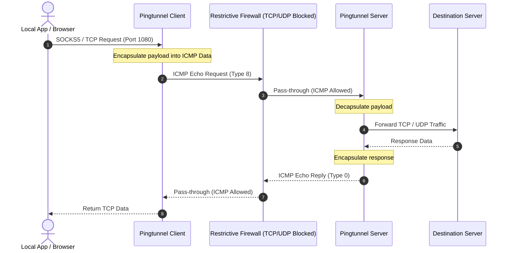

# Pingtunnel (ICMP Tunneling Engine)

<div align="center">


**High-Performance Network Tunneling Tool: Encapsulate TCP/UDP & SOCKS5 Traffic over ICMP (Ping) Packets.**

[English Documentation](#english-documentation) • [راهنمای جامع فارسی](#راهنمای-جامع-فارسی-persian-guide)

</div>

---

> [!WARNING]
> **Research & Authorized Testing Only**: This tool is provided for educational, network security research, and authorized diagnostic purposes. Always obtain explicit authorization before deploying in private or enterprise networks.

---

<a name="english-documentation"></a>
## Overview

In highly restricted network environments, corporate firewalls or captive portals frequently drop all inbound/outbound TCP and UDP traffic while permitting standard ICMP echo packets (`ping`) for link monitoring and latency diagnostics.

**Pingtunnel** establishes a covert, bidirectional data transport layer by encapsulating application-layer payload (TCP, UDP, or full SOCKS5 streams) inside standard ICMP Echo Request (Type 8) and Echo Reply (Type 0) payloads.



---

## Core Capabilities

- **Arbitrary Protocol Encapsulation**: Tunnels raw TCP streams, UDP datagrams, or local SOCKS5 proxy connections.
- **Built-in SOCKS5 Server**: Provides a turnkey local SOCKS5 endpoint on client machines with zero extra proxy configuration.
- **Authentication Key**: Protects server endpoints from unauthorized relay using integer-based pre-shared authentication keys (`-key`).
- **High Throughput & Adaptive Windows**: Optimized buffer management minimizing packet loss over lossy cellular or satellite links.
- **Cross-Platform Support**: Linux, Windows, macOS, Android, and containerized Docker environments.

---

## Deployment & Usage

### 1. Server Setup (Linux VPS)

Run on an internet-accessible server with root privileges (required for raw ICMP socket access):

```bash
# 1. Download and extract binary
wget https://github.com/esrrhs/pingtunnel/releases/latest/download/pingtunnel_linux64.zip
unzip pingtunnel_linux64.zip

# 2. (Recommended) Suppress kernel response to avoid OS-level echo duplicate
echo 1 | sudo tee /proc/sys/net/ipv4/icmp_echo_ignore_all

# 3. Start server with an authentication key
sudo ./pingtunnel -type server -key 847291
```

#### Via Docker (Server):
```bash
docker run --name pingtunnel-server -d \
  --privileged \
  --network host \
  --restart always \
  esrrhs/pingtunnel ./pingtunnel -type server -key 847291
```

---

### 2. Client Setup

#### A. SOCKS5 Proxy Mode (Recommended)
Spawns a local SOCKS5 proxy on `127.0.0.1:4455`:

```bash
# Windows (Run as Administrator)
pingtunnel.exe -type client -l :4455 -s SERVER_IP -sock5 1 -key 847291

# Linux / macOS
sudo ./pingtunnel -type client -l :4455 -s SERVER_IP -sock5 1 -key 847291
```

#### B. Direct Port Forwarding (TCP / UDP)
Forward a specific remote service (e.g., SSH on port 22 or WireGuard on port 51820):

```bash
# Forward remote SSH (port 22) to local port 2222:
sudo ./pingtunnel -type client -l :2222 -s SERVER_IP -t SERVER_IP:22 -tcp 1 -key 847291

# Forward remote UDP port 51820 to local port 51820:
sudo ./pingtunnel -type client -l :51820 -s SERVER_IP -t SERVER_IP:51820 -key 847291
```

---

<a name="راهنمای-جامع-فارسی-persian-guide"></a>
## راهنمای جامع فارسی (Persian Guide)

پروژه **Pingtunnel** یکی از شاخص‌ترین ابزارهای تونل‌سازی و کپسوله‌سازی ترافیک شبکه (Network Encapsulation) است که امکان ارسال و دریافت بسته‌های TCP و UDP را بر بستر پروتکل ICMP (همان بسته‌های پینگ) فراهم می‌کند.

### چرا تونل ICMP؟
در برخی شبکه‌ها، هتل‌ها، پروازها، محیط‌های آکادمیک یا شبکه‌های سازمانی با فایروال‌های سخت‌گیرانه، تمامی پورت‌های TCP و UDP مسدود می‌شوند، اما برای پایش کیفیت اتصال و بررسی پایداری شبکه، بسته‌های ICMP باز می‌مانند. Pingtunnel داده‌های شما را درون بسته ICMP پنهان کرده و از فایروال عبور می‌دهد.

### نحوه استفاده سریع

#### ۱. راه‌اندازی سرور (لینوکس با دسترسی Root)
```bash
sudo ./pingtunnel -type server -key 123456
```
*(اختیاری: برای جلوگیری از پاسخ اضافه کرنل لینوکس به پینگ‌های عادی: `echo 1 > /proc/sys/net/ipv4/icmp_echo_ignore_all`)*

#### ۲. اتصال کلاینت در حالت پروکسی SOCKS5
```bash
# در ویندوز (اجرا در PowerShell به عنوان Administrator)
pingtunnel.exe -type client -l :1080 -s YOUR_SERVER_IP -sock5 1 -key 123456
```
پس از مشاهده لاگ‌های ping/pong، یک پروکسی SOCKS5 روی پورت ۱۰۸۰ سیستم شما ایجاد می‌شود.

---

## License

This software is released under the **MIT License**.
